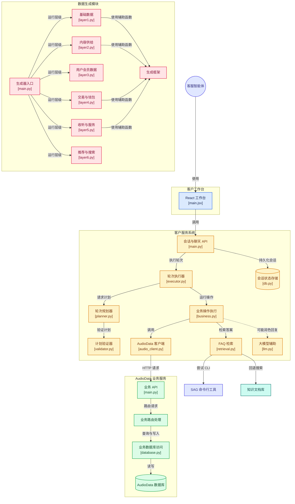
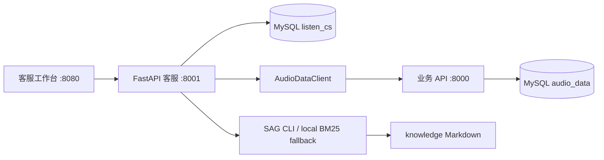

# 听书平台智能客服系统

面向听书业务的客服工作台，包含 FastAPI 客服服务、持久化会话状态、业务 API 客户端、FAQ 检索和 React/Vite/Tailwind 工作台。业务数据只由 `audio-data` 服务写入；客服会话与消息只写入 `listen_cs`。

## 设计简述

- 用途：客服会话处理与业务数据查询。
- 关键交互：聊天时间线与任务/槽位检查器并排，便于观察每轮状态变化。
- 页面：桌面三栏（历史、对话、检查器），移动端聊天单栏并可展开历史或状态。
- 会话以 Turn 为单位呈现，一条用户消息及客服文本/业务卡片共享 `turn_id`。

### 系统架构

## API

- 所有会话和聊天请求支持 `X-User-Id`，客服服务将编号透传给 audio-data，由业务 API 按真实用户过滤订单、播放记录与权益。工作台默认读取 `AUDIO_DATA_USER_ID`，切换用户后会清空当前选择并只加载该用户的会话。
- `GET /health`：健康检查，返回 `{"status":"ok"}`。
- `GET /meta`：读取默认用户编号。
- `POST /session`：创建当前用户的持久会话，返回 `sessionId`。
- `GET /sessions`：列出当前用户的会话。
- `PATCH /session/{id}`：请求 `{ "title": "会话名称" }`，重命名当前用户会话。
- `DELETE /session/{id}`：删除会话及其消息和状态。
- `DELETE /session/{id}/history`：清空消息并重置流程状态。
- `GET /session/{id}/history`：按 Turn 读取持久化问答，返回 `turns[]`；每轮含 `turn_id`、`user` 与 `assistant[]` 文本/卡片块。升级时会把旧消息归并到原用户消息对应的轮次。
- `GET /session/{id}/state`：读取当前任务、槽位、挂起栈和待执行命令队列。
- `POST /chat`：JSON `{ "sessionId": "…", "message": "…", "objects": [] }`，返回完整回复、意图与状态。
- `POST /chat/stream`：请求可带前端生成的 `turnId`，SSE 的 `token` 与 `done` 均带回该轮 ID。
- `GET /catalog/orders`、`GET /catalog/albums`：按当前 `X-User-Id` 查询可附加的真实订单和专辑；工作台的业务对象选择器只展示接口返回的数据。
- `GET /catalog/context`：返回当前用户资料、钱包、订单、书架、播放记录与热门专辑，供工作面板实时展示。

消息元数据保存执行轨道、来源、流程槽位、挂起栈和卡片；服务日志记录轨道、分支、任务、槽位、栈深度和耗时。AudioDataClient 对 HTTP 调用设 10 秒超时并捕获失败。

### 部分截图展示

## 数据与接口依据

### 表结构、枚举和字段来源

`audio-data/sql/audio.sql` 是业务表结构来源；`audio-data/app/routers/` 定义 HTTP 路由、请求与响应字段。业务库在本 Compose 中为 `audio_data`；客服表在 `listen_cs`。客服 API 调用业务服务时使用 `X-User-Id`，默认用户由 `AUDIO_DATA_USER_ID`（默认 `10001`）配置，页面的当前用户编号将通过 `X-User-Id` 传递。

### 场景映射清单

| 客服场景 | 使用表 / 接口 | 字段与样本形态 |
|---|---|---|
| 悬疑/高评分专辑 | `audio_album`, `audio_track`, `album_author_rel`, `album_narrator_rel`, `album_tag_rel`; `GET /api/v1/albums?albumType=audiobook&sortBy=rating` | `albumTitle`, `ratingScore`, `trackCount`, `totalDurationSeconds`, `summary`；详情另含 `authors[].authorName`、`narrators[].narratorName` |
| 按标题查专辑章节 | `audio_album`, `audio_track`; `GET /api/v1/search?keyword={title}&searchType=all&channelId=1`，详情 `GET /api/v1/albums/{albumId}` 与 `/tracks` | 搜索项 `title`, `summary`, `album.albumId`; 详情 `albumTitle`, `trackCount`, `narrators`；无匹配时返回真实未找到提示 |
| 订单状态与商品 | `content_order`, `content_order_item`, `payment_record`; `GET /api/v1/orders` 与 `GET /api/v1/orders/{orderId}` | `orderNo`, `orderStatus`, `payableAmount`, `paidAt`; 明细 `itemName`; 支付 `paymentStatus`, `paymentAmount`, `paidAt`。详情路由按数字 `orderId`，客服先在当前用户订单列表中匹配业务订单号 |
| 最近播放 | `listening_progress`, `audio_album`, `audio_track`; `GET /api/v1/listening-progress` | `albumTitle`, `trackTitle`, `positionSeconds`, `durationSeconds`, `lastPlayedAt` |
| 会员与权益 | `member_account`, `vip_plan`, `entitlement_record`; `GET /api/v1/vip-plans`, `GET /api/v1/entitlements` | `memberLevel`, `memberStatus`, `validTo`; 套餐 `planName`, `durationDays`, `salePriceAmount`; 权益 `targetType`, `entitlementStatus` |
| 退款申请 | `content_order`, `content_order_item`, `payment_record`, `refund_record`, `refund_record_item`; `POST /api/v1/refunds` | 请求 `paymentId`, `refundReason`, `items[{orderItemId,refundQuantity,refundAmount}]`; 结果 `refund.refundNo`, `refundStatus` |
| 客服工单 | `support_ticket`; `POST /api/v1/support-tickets` | `ticketType` 枚举：`feature_feedback/usage_feedback/copyright_complaint/payment_issue/account_issue/content_issue/other`; 请求 `relatedType`, `ticketTitle`, `ticketContent`; 返回 `ticketNo`, `ticketStatus` |
| FAQ/规则 | `knowledge/*.md`; `sag "用户问题" -m 5` | 返回命中段落和 Markdown 来源路径；CLI 不可用时使用本地关键词匹配 |

示例业务单号格式由生成器 `audio-data/generate/layers/layer4.py` 产生，例如 `ORD000000000001`；真实字段值应以本次 full profile 生成的数据及 API 返回为准。退款枚举来自 `refund_record.refund_status`：`requested/approved/rejected/success/failed`。退款接口需成功支付流水，并对内容订单提交金额明细。客服系统不直接写业务库。

## 对话能力

- 轨道规划：`TurnPlanner` 可请求受限 JSON 计划，`TurnPlanValidator` 规范化并校验后由 `TurnExecutor` 执行；LLM 不可用或输出不可修复时使用确定性规则计划。Executor 不再用关键词二次判断取消、继续、闲聊或跨流程意图，只执行校验后的任务命令。
- 对话轨道：Task（订单/播放查询、退款、工单、购买引导）、Knowledge（专辑/会员/FAQ 单轮问答）、Chitchat（闲聊与情绪表达）。Chitchat 优先用 LLM 生成自然回复，未配置或失败时使用情境化回退。
- 业务卡片上下文：用户消息中的订单、专辑、播放卡片会展开核心 JSON 字段后写入历史与 Planner Prompt，例如 `order_id/status/amount`、`title/rating/track_count`。当前聚焦对象的真实字段也会注入 Planner，支持“这个评分高吗”“这个订单能退吗”等追问。
- 槽位锁定：当前流程正在收集槽位时，普通文本作为该槽位值交给 Planner 生成 `SetSlots`，Executor 不做词库式闲聊拦截。Planner 只做窄修复：补当前锁定槽位、为首轮明确订单号补 `order_id`、确认附件对象；不会自行切换流程，也不会提前启动 `pending_commands` 中的排队任务。
- 流程控制：`app/flow_config/user_flows.yml` 定义退款、工单、订单/播放查询和购买引导流程。任务状态支持挂起、恢复、放弃和取消；任务完成后若存在挂起任务，会明确要求用户选择“继续任务名”或“放弃任务名”，放弃会清理整个挂起队列。
- 多意图排队：同一轮中的连续 `StartFlow` 会按顺序执行；当前流程需要补充槽位时，后续流程暂存到 `pending_commands`，当前流程完成后自动继续。
- 宽容校验：`SetSlots` 中未定义槽位只告警并丢弃，不直接转澄清；只有流程 ID 不存在或触发 `MULTIPLE_TRACKS` 等无法安全执行的情况才进入澄清。
- 错误降级：退款/工单 Action 遇到明确业务拒绝（订单状态不可退、无成功支付记录等）会返回原因并把状态机重置为空闲；网络超时或上游 5xx 则保留当前流程和已填槽位，提示稍后重试。
- LLM：可用于受限计划、闲聊回复和 FAQ/RAG 回复润色；配置兼容 OpenAI 的 DashScope 地址、`qwen-max` 与 `LLM_API_KEY`。业务动作不会由模型直接执行。
- SAG-Wiki：客服 API 以子进程调用 `sag`，超时 10 秒；非零退出、空结果或缺少 CLI 时回落至 `knowledge/` 本地中文 bigram BM25 召回。

## 外部依赖说明

客服服务会尝试调用 `sag` CLI（10 秒超时）；CLI 缺失、非零退出、超时或输出为空时，自动使用 `knowledge/` 文档的本地中文 bigram BM25 检索，并返回原文段落及来源路径。配置了 `LLM_API_KEY` 时，LLM 可对 FAQ 命中内容做回复润色；失败时使用检索结果。

前端通过同源 `/api/` 路径请求客服服务，Nginx 在 8080 端口代理到 `customer-service:8001`，包含 SSE 流式响应，不需要浏览器跨域访问 8001。

## 生产环境使用说明

生产部署应将 `AUDIO_DATA_BASE_URL` 指向正式业务 API，将 `LISTEN_CS_DSN` 指向独立客服状态库，并通过可信登录态在网关校验用户身份后设置 `X-User-Id`。不要接受客户端任意用户编号作为生产身份凭据；工作台中的用户编号输入仅适用于受控运营场景。客服查询会把该用户编号传给 audio-data，由业务服务返回对应的真实业务记录。退款和工单通过 audio-data 写接口提交，客服服务不直接修改 `audio_data`。会话标题、消息、卡片元数据和任务槽位保存在 `listen_cs`，支持用户范围内的读取、重命名、清空和删除。

专辑、播放和订单卡片的数据由业务接口生成；缺失的真实字段保持为空或显示未提供，不使用内置演示记录。新增业务对象时，应在 audio-data 暴露经授权的查询接口，由工作台通过 API 获取可选项。

## 简单架构图

业务数据只通过 audio-data API 读取或执行受支持的退款/工单写入；客服自己的会话、消息和任务状态仅写入 `listen_cs`。
