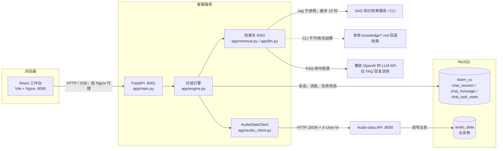

# 系统架构设计

## 系统边界与拓扑

图中 `FastAPI2` 是独立的 `audio-data` FastAPI 服务；本地 compose 里客服和业务 API 共用 MySQL 容器，但使用 `listen_cs` 与 `audio_data` 两个数据库。浏览器只访问工作台同源 `/api`，由 Nginx 代理客服 API。SAG 是外部知识检索入口；检索代码会在命令失败、超时或无输出时用项目本地 `knowledge/` Markdown 做 BM25 风格回退。LLM 凭证配置可选，且只用于 FAQ 命中内容的简洁改写。

## 核心模块

### 意图识别

`app/intents.py::classify_intent` 通过关键词计分，产出 `intent`、`confidence`、`runner_up` 和 `margin`。`app/engine.py::run` 使用 `confidence >= 0.55` 且 `margin >= 0.15` 作为自动分流门槛。当前识别类别包括 `refund_request`、`ticket_submit`、`order_query`、`book_query`、`playback_query`、`membership_query`、`faq`、`chitchat` 与 `unknown`。

对话引擎先形成三轨计划。配置有 LLM 时 `llm.plan_turn` 请求受限 JSON 计划，由允许的轨道/意图枚举校验；不合法或不可用时回到确定性规则。高置信度的显式业务关键词优先于模型建议。计划只负责路由，不直接执行业务动作；退款、工单仍由 Python Action 和槽位状态机执行。闲聊优先调用 LLM 自然语言生成；LLM 不可用时按情境给出非菜单式回应。

### 任务型状态机（Slot Filling）

任务定义位于 `engine.py` 的 `FLOW`、`PROMPT`：退款需要 `order_id/reason/refund_type`，工单需要 `ticket_type/order_id/description`。部分退款会动态增加 `refund_amount`。`extract_slot` 先识别附加订单和订单号，再按当前缺失槽位解析用户回答；`advance_task` 在槽位齐全后调用 `execute`，由 `AudioDataClient` 请求业务 API。退款/工单不会由 LLM 直接执行。

### 信息检索（业务 API 与 RAG）

订单、专辑、播放、会员等查询通过 `answer` 使用 `AudioDataClient` 调用 audio-data API；退款及工单通过 `execute` 调用业务写接口。FAQ 由 `retrieve` 调用 SAG，无法使用时回退本地 Markdown 匹配，再由 `rag_reply` 可选润色。检索出的段落会附在回复中，保留来源信息。客服服务不直接访问或写入 `audio_data` 数据库。

### Turn 与状态持久化

系统没有独立的 Turn ORM/领域类。`run` 为一轮生成或接收 `turn_id`，将用户消息和客服消息分别写入 `chat_message`，二者共享此 ID；回复中的意图、来源、卡片及状态快照放在 JSON 元数据中。`GET /session/{id}/history` 按 `turn_id` 聚合为前端所需的轮次结构。当前流程状态单独以整份 JSON 写入 `chat_task_state`，重启后由 `get_state` 恢复。

## 轨道与状态栈

这是当前实现的分流视图；任务/槽位约束仍在 Python 中定义，尚未外置为 YAML：

| 轨道 | 责任 | 例子 | 实现 |
|---|---|---|---|
| Task | 状态化业务任务，包含查询型任务和多轮 Action | 查订单、查播放记录、退款、工单、购买意图导引 | `FLOW`、`extract_slot`、`advance_task`、`execute` |
| Knowledge | 单轮专辑、会员或规则问答 | 查专辑、会员权益、退款政策 | `answer`、`retrieve`、`rag_reply` |
| Chitchat | 情绪和闲聊，不调用业务 API | “我非常开心”、问候、感谢 | `plan_turn`、`llm.chitchat_reply`，规则回退 |
| Clarification | 仍无法识别时做简短澄清 | 未覆盖意图 | `run`，不再返回固定业务菜单 |

任务中断与恢复规则：

1. 用户开始退款后，`current_task=refund_request`，槽位逐轮保存在 `slots_json`。
2. 若退款尚未完成时用户明确要求查订单/播放/会员等，`run` 将当前任务与槽位快照 Push 到 `suspended_stack`，处理查询，然后 Pop 最近快照并询问是否继续。
3. 用户回复“继续”时，`awaiting_resume` 被清除，并重新询问当前任务第一个缺失槽位；拒绝/取消则由全局取消规则清空任务和栈。
4. 若当前任务的槽位已完整，`advance_task` 执行当前任务；成功后若栈非空则 Pop 并恢复挂起任务。
5. 用户明确开始另一种任务时，旧任务快照 Push，新任务变为当前任务。

这类似 LIFO 栈，但 `restore_after_subtask` 在一次调用中 Pop 一个元素。恢复行为有显式确认状态 `awaiting_resume`。购买目前没有下单 Action：退款中收到购买意图时，退款快照入栈，系统回到 Idle 并引导用户去听书客户端购买；用户回复“继续”可恢复退款。

## focused_object 业务对象聚焦

每轮请求包含 `objects` 时，引擎先规范化最新对象并将它保存为会话 `focused_object`，同时写入该轮用户消息 `metadata_json.objects`。`chat_task_state.focused_object_json` 保存最新聚焦对象，状态 API 将它返回。无明确动作时，客服按对象类型和标题确认收到并询问用户目标；订单对象可以填充退款/工单的订单号槽位。历史 API 将附件同时作为 `user.objects` 和 `user.cards` 返回，React 时间线据此渲染用户消息中的业务卡片。

## 当前设计边界与演进方向

- 持续扩充路由 schema 与规则回退，为规划结果保留可审计日志和回归用例。
- 将 LLM 规划输出校验进一步细化到槽位和 Action 参数；业务动作仍由确定性 Python Action 执行。
- 将轨道和槽位约束外置 YAML，并保留 Python Action 注册表，便于业务流程审阅和版本化。
- 为附件对象扩充类型/ID 校验与上下文查询；目前已有 focused object 持久化和历史卡片回放，但专辑对象不会自动触发专辑详情查询。
- 将消息写入、状态更新与业务副作用的幂等策略进一步明确；目前 `run` 先落用户消息再处理，写消息和状态不是一个数据库事务。
