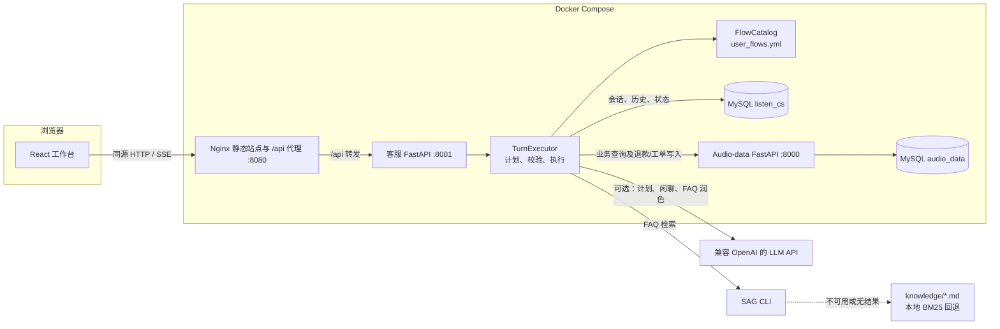
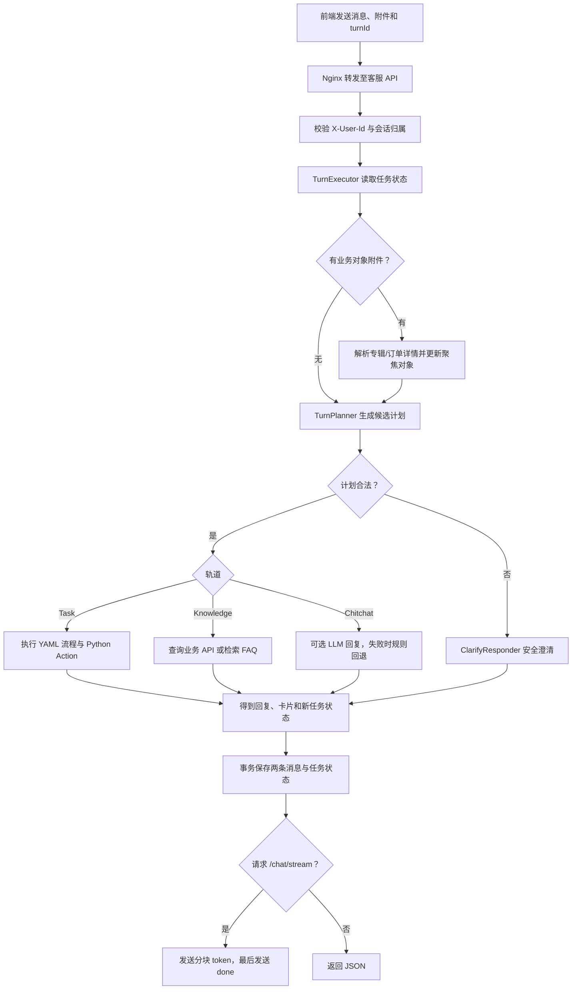
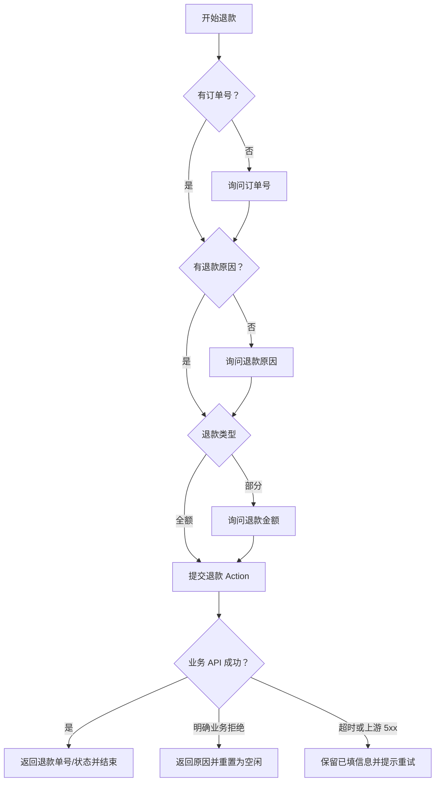

# 系统架构设计

## 系统边界与部署拓扑

Compose 中的 `mysql` 是同一个 MySQL 容器，但客服库 `listen_cs` 和业务库 `audio_data` 由不同服务负责。客服服务不直接读写 `audio_data`，而是通过带 `X-User-Id` 的 `AudioDataClient` 调用业务 API。退款和工单也由业务 API 校验并写入。前端访问工作台同源地址，Nginx 将 `/api` 请求代理给客服 API。

## 单轮对话流程

下面展示从请求到持久化响应的主路径。状态读取、业务动作和知识检索会按计划选择；所有完成的轮次都在客服数据库事务中一起保存用户消息、客服回复与新状态。

`/chat/stream` 目前先同步执行完整轮次，之后将最终文本按每 20 个 Python 字符切块发送，因此提供的是分块传输，不是模型生成 token 与业务处理并行。请求可以携带 `turnId`；未提供时由服务端生成。用户消息与客服消息共用同一 `turn_id`。

## 对话引擎：Plan → Validate → Execute

入口位于 `app/engine/__init__.py`，核心编排器是 `app/engine/executor.py::TurnExecutor`。

1. `TurnPlanner` 汇总最近对话、任务状态、聚焦对象和 YAML 流程摘要。用户消息中的订单、专辑、播放卡片会先展开核心 JSON 字段再进入 Prompt；当前聚焦对象的真实字段也会注入。配置 `LLM_API_KEY` 时请求受限 JSON 计划；无凭证、调用失败或输出不可修复时由规则生成候选计划。
2. `TurnPlanValidator` 校验并规范化计划。轨道、流程 ID 和命令顺序属于安全边界；未定义槽位、无效槽位值、失效的 `ResumeTask` 等只告警并丢弃，不直接转澄清。只有流程不存在或触发 `MULTIPLE_TRACKS` 等无法安全执行的情况才交由 `ClarifyResponder`。
3. `TurnExecutor` 不再根据用户文本做 `_is_cancel`、`_is_resume`、`_is_chitchat` 等二次判断。只要计划通过校验，Executor 就按 `task_commands` 执行；槽位锁定由 Planner 的 `SetSlots` 和 Validator 的规范化保证。Planner 的修复范围仅限于当前锁定槽位、首轮消息中的明确订单号、附件对象确认，以及阻止模型提前启动 `pending_commands` 中的排队任务。
4. 任务流程由 `FlowCatalog` 从 `app/flow_config/user_flows.yml` 加载并验证。`collect`、`action`、`response` 等步骤由执行器驱动；Action 名称通过 Python 注册表映射到确定性函数。
5. 业务查询和写操作由 `app/engine/business.py` 与 `app/audio_client.py` 调用 audio-data。FAQ 检索由 `app/retrieval.py` 先尝试 SAG CLI，再回退至本地 `knowledge/*.md`；可选 LLM 仅用于 FAQ 回复润色或闲聊/规划。

### 流程配置和槽位

流程和槽位定义已经外置为 YAML，不是硬编码在 Python `FLOW` 常量中。当前流程包括退款、工单、订单查询、播放进度查询和购买引导。退款流程收集 `order_id`、`refund_reason`、`refund_type`；部分退款还需要 `refund_amount`。工单流程收集 `ticket_type`、可选订单号 `order_id`（无订单时可填 `none`）和 `issue_desc`。

执行 Action 时，退款业务会由 audio-data 校验订单归属、支付记录和退款明细；工单也通过业务 API 创建。明确业务拒绝（订单状态不可退、无成功支付记录、金额非法等）会重置 `current_task` 和槽位，避免死循环；网络超时或上游暂不可用会保留当前流程及已收集槽位。

## 任务中断、恢复、放弃与队列

- `chat_task_state` 保存 `current_task`、`slots_json`、`suspended_stack_json`、`awaiting_resume`、`focused_object_json`、`pending_commands_json` 和 `pending_query`。
- 明确发起另一项 Task 时，当前任务、槽位和聚焦对象快照压入挂起栈；查询子任务完成后，系统会列出挂起任务，要求用户明确选择“继续 任务名”或“放弃 任务名”。`AbandonTask` 会清空整个挂起栈。
- “取消”清空当前流程、槽位、挂起栈和待执行队列；活动流程中的“继续”由 Planner 决定是重复当前提示还是恢复挂起任务。
- 同一轮中的连续 `StartFlow` 形成有序任务队列。当前流程需要补充槽位时，后续命令暂存到 `pending_commands_json`；当前流程完成后自动继续。多个流程的结果会合并到同一轮回复，不覆盖前一个任务结果。
- 附加订单或专辑会先向业务 API 解析详情，并保存为聚焦对象。订单对象可通过 Planner 的 `SetSlots` 填充 `order_id`；历史消息和 Planner Prompt 都保存展开后的卡片核心字段。知识回答不再清空聚焦对象，便于连续追问评分、作者、进度等信息。

## 持久化与一致性

客服库由 `app/db.py` 管理，包含 `chat_session`、`chat_message`、`chat_task_state` 三张表。`persist_turn` 在一个 MySQL 事务中锁定会话状态行，并一起更新任务状态、写入共享 `turn_id` 的用户/客服消息、更新会话活动时间。事务只覆盖客服自己的数据；audio-data 的业务动作是独立 HTTP 请求，不与客服库事务构成分布式事务。

启动时 `db.initialize()` 会创建表、补齐新增列、迁移旧消息的 `turn_id` 并回填旧会话的默认用户编号。`GET /session/{id}/history` 将消息按 `turn_id` 聚合为轮次，`GET /session/{id}/state` 返回持久化流程快照。

## 主要模块

| 模块 | 职责 |
|---|---|
| `app/main.py` | FastAPI 路由、用户范围校验、同步及 SSE 聊天接口。 |
| `app/engine/executor.py` | 状态读取、计划校验、命令队列、流程执行、Action 错误分层和轮次提交。 |
| `app/engine/planner.py` | LLM 计划请求、卡片上下文注入及确定性规则回退。 |
| `app/engine/validator.py` | 计划 schema、命令顺序、槽位规范化和 `MULTIPLE_TRACKS` 安全边界。 |
| `app/engine/clarify.py` | 基于缺失槽位、挂起栈和历史上下文的精准澄清。 |
| `app/engine/history_builder.py` | 历史消息与业务卡片核心字段渲染。 |
| `app/engine/configuration.py` | 加载和校验 YAML 流程目录。 |
| `app/engine/business.py` | 业务查询、退款/工单写入、FAQ 与卡片辅助逻辑。 |
| `app/audio_client.py` | 带用户编号的 audio-data HTTP 客户端，超时 10 秒。 |
| `app/retrieval.py`、`app/llm.py` | SAG/本地知识检索及可选 LLM 能力。 |
| `app/db.py` | 客服表结构迁移、轮次与状态事务持久化。 |
| `frontend/src/main.jsx` | React 工作台、聊天请求及 SSE 消费。 |
| `frontend/nginx/default.conf` | 静态资源和 `/api` 反向代理。 |

## 已知边界

- LLM 规划和知识润色均为可选能力；没有凭证或调用失败时依赖规则回退/本地检索。
- 客服数据库事务不能回滚已由 audio-data 成功完成的外部业务写入；跨服务重试和幂等由业务 API 负责。
- `/chat/stream` 在完整轮次处理完成后才发送文本分块。
